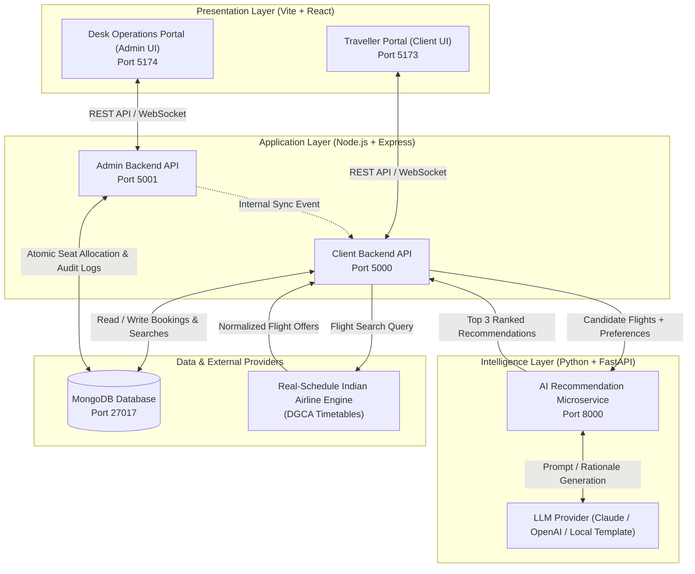
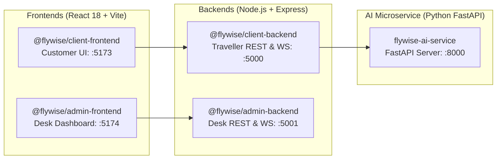
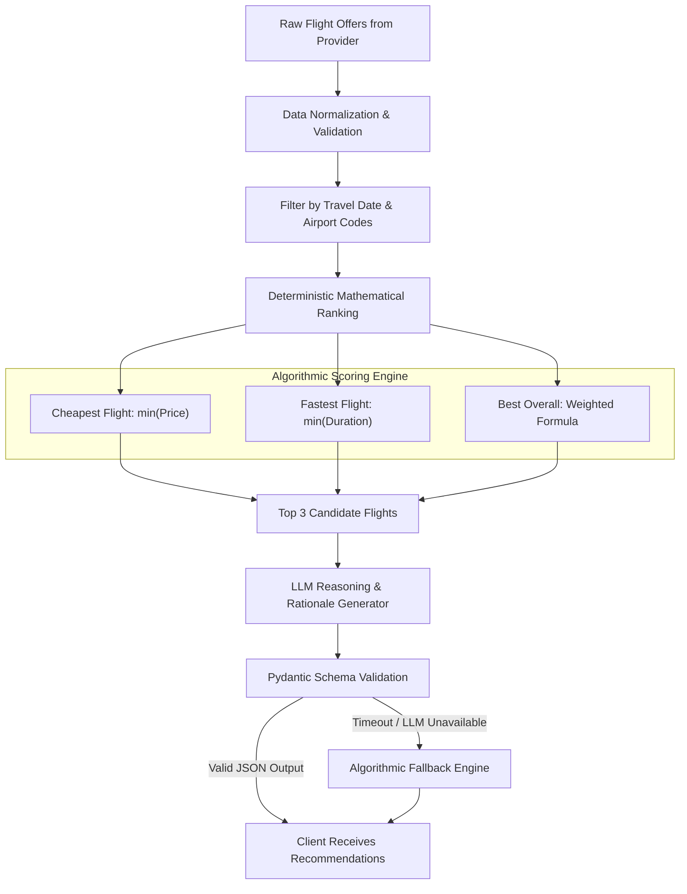
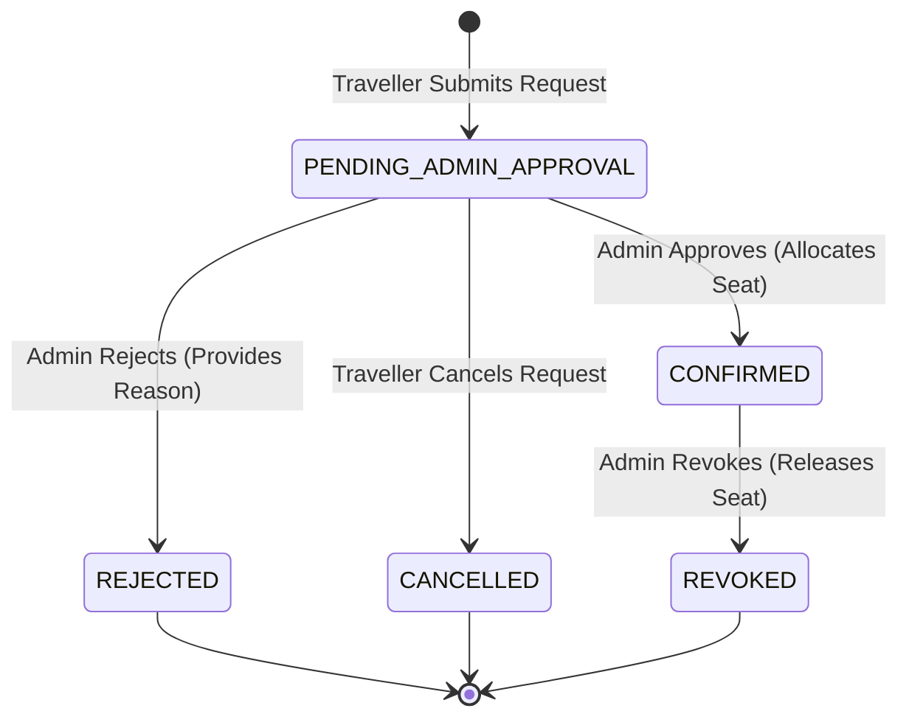
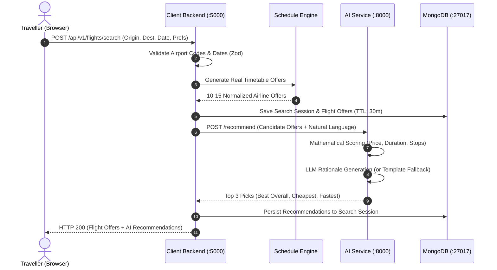
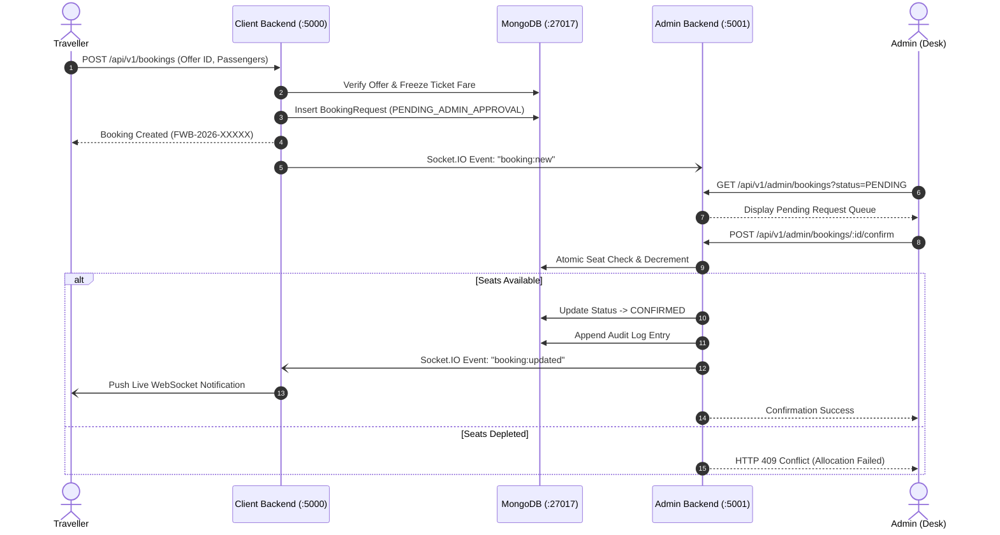
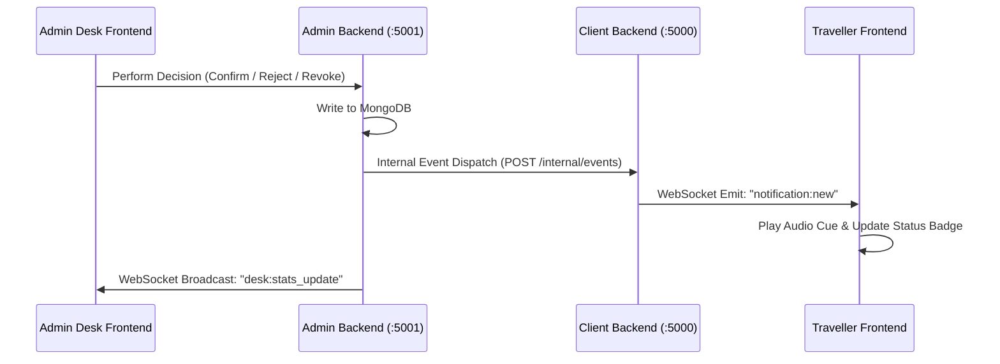
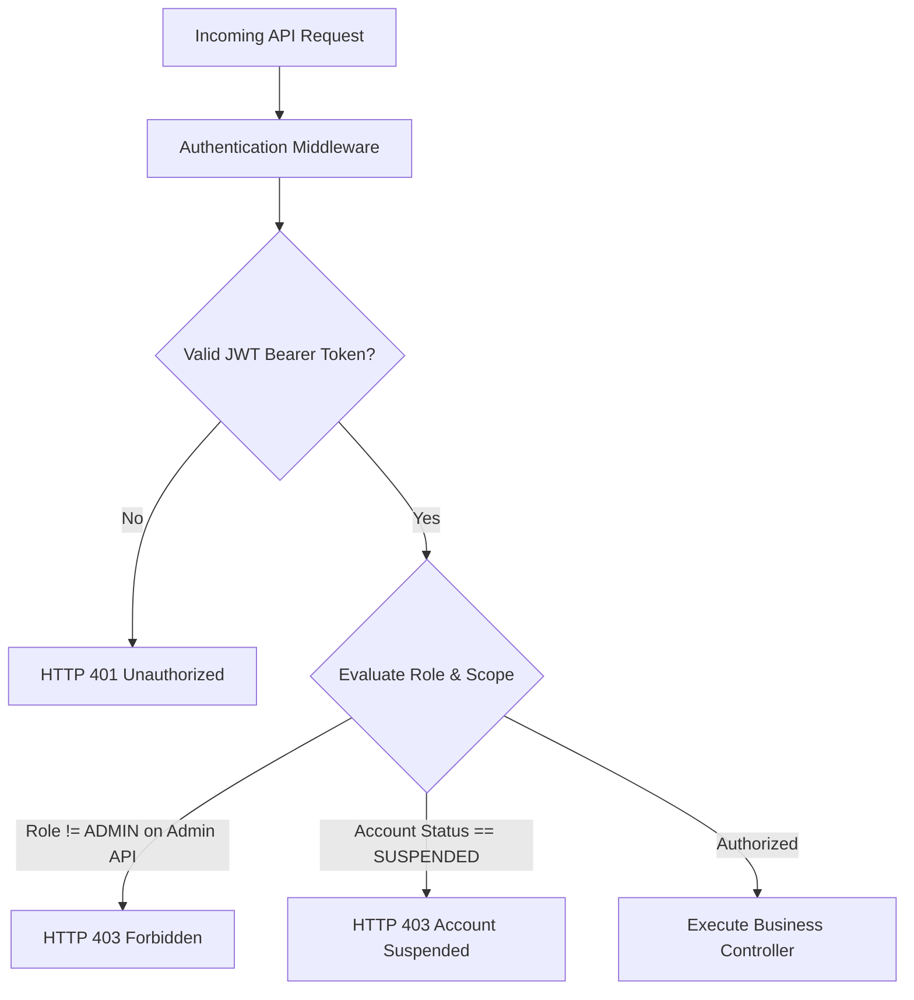
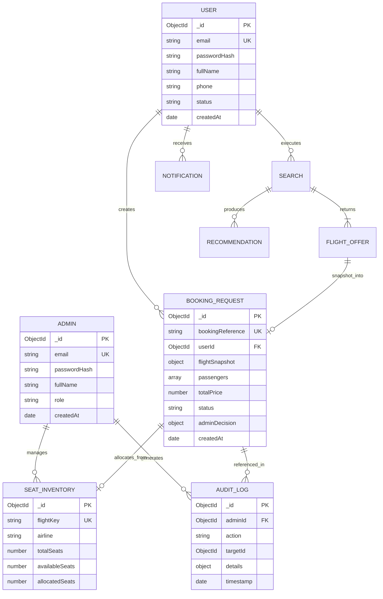
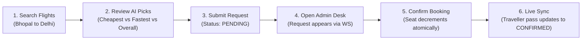

# FlyWise AI: Intelligent Flight Discovery & Booking Platform

> **Academic Minor Project Blueprint & Technical Report Specification**  
> **Domain**: Artificial Intelligence + Full-Stack Distributed Systems + Real-Time Engine  
> **Tagline**: *Discover smarter routes. Compare intelligent recommendations. Book with confidence.*

---

## Table of Contents

1. [Executive Summary & Project Ideation](#1-executive-summary--project-ideation)
   - [1.1 Problem Statement](#11-problem-statement)
   - [1.2 Proposed Solution](#12-proposed-solution)
   - [1.3 Core Objectives](#13-core-objectives)
   - [1.4 Project Scope & Boundaries](#14-project-scope--boundaries)
2. [System Architecture & High-Level Design](#2-system-architecture--high-level-design)
   - [2.1 Overall System Architecture](#21-overall-system-architecture)
   - [2.2 Layered Architectural Breakdown](#22-layered-architectural-breakdown)
   - [2.3 Multi-Service Architecture](#23-multi-service-architecture)
   - [2.4 Port Allocation & Network Matrix](#24-port-allocation--network-matrix)
3. [Technology Stack & Architectural Decisions](#3-technology-stack--architectural-decisions)
   - [3.1 Technology Matrix](#31-technology-matrix)
   - [3.2 Architectural Separation: Frontends & Backends](#32-architectural-separation-frontends--backends)
   - [3.3 Real-World Airline Timetable Engine](#33-real-world-airline-timetable-engine)
   - [3.4 The Non-Negotiable AI Rule](#34-the-non-negotiable-ai-rule)
4. [AI Recommendation Microservice](#4-ai-recommendation-microservice)
   - [4.1 Hybrid Recommendation Philosophy](#41-hybrid-recommendation-philosophy)
   - [4.2 Mathematical Multi-Criteria Scoring Model](#42-mathematical-multi-criteria-scoring-model)
   - [4.3 Natural Language Preference Parsing Pipeline](#43-natural-language-preference-parsing-pipeline)
   - [4.4 LLM Guardrails & Hallucination Defenses](#44-llm-guardrails--hallucination-defenses)
   - [4.5 High-Availability Fallback Engine](#45-high-availability-fallback-engine)
5. [Booking Lifecycle & State Management](#5-booking-lifecycle--state-management)
   - [5.1 Finite State Machine (FSM) Specification](#51-finite-state-machine-fsm-specification)
   - [5.2 State Transition Diagram](#52-state-transition-diagram)
   - [5.3 CRUD Operation Mapping](#53-crud-operation-mapping)
   - [5.4 Concurrency Control & Atomic Seat Allocation](#54-concurrency-control--atomic-seat-allocation)
6. [End-to-End System Workflows](#6-end-to-end-system-workflows)
   - [6.1 Flight Search & Recommendation Sequence](#61-flight-search--recommendation-sequence)
   - [6.2 Complete Booking Request & Admin Decision Sequence](#62-complete-booking-request--admin-decision-sequence)
   - [6.3 Real-Time WebSocket Notification Architecture](#63-real-time-websocket-notification-architecture)
7. [Security & Role-Based Access Control (RBAC)](#7-security--role-based-access-control-rbac)
   - [7.1 Dual-Token Authentication Architecture](#71-dual-token-authentication-architecture)
   - [7.2 Authorization Pipeline & RBAC Decision Tree](#72-authorization-pipeline--rbac-decision-tree)
   - [7.3 Data Defense & Injection Mitigation](#73-data-defense--injection-mitigation)
8. [Database Architecture & Data Models](#8-database-architecture--data-models)
   - [8.1 Entity-Relationship (ER) Diagram](#81-entity-relationship-er-diagram)
   - [8.2 MongoDB Collection Schemas](#82-mongodb-collection-schemas)
9. [Complete REST API Reference](#9-complete-rest-api-reference)
   - [9.1 Client Backend APIs](#91-client-backend-apis)
   - [9.2 Admin Backend APIs](#92-admin-backend-apis)
   - [9.3 AI Recommendation Microservice APIs](#93-ai-recommendation-microservice-apis)
10. [Frontend Architecture & UI Component Inventory](#10-frontend-architecture--ui-component-inventory)
    - [10.1 Traveller Portal (Client Frontend)](#101-traveller-portal-client-frontend)
    - [10.2 Desk Operations Portal (Admin Frontend)](#102-desk-operations-portal-admin-frontend)
    - [10.3 Shared Design System](#103-shared-design-system)
11. [Codebase Organization & Monorepo Layout](#11-codebase-organization--monorepo-layout)
12. [Environment Configuration Reference](#12-environment-configuration-reference)
13. [Installation & Execution Guide](#13-installation--execution-guide)
    - [13.1 Prerequisites](#131-prerequisites)
    - [13.2 Automated Setup](#132-automated-setup)
    - [13.3 Starting the Services](#133-starting-the-services)
    - [13.4 Database Seeding & Resetting](#134-database-seeding--resetting)
    - [13.5 Default Credentials](#135-default-credentials)
14. [Testing & Quality Assurance](#14-testing--quality-assurance)
15. [Academic Viva & Demonstration Walkthrough](#15-academic-viva--demonstration-walkthrough)
16. [Project Limitations & Future Enhancements](#16-project-limitations--future-enhancements)

---

## 1. Executive Summary & Project Ideation

### 1.1 Problem Statement
Modern flight booking systems frequently overwhelm users with endless, unsorted tables containing dozens of itinerary options. Travellers must manually balance:
- Total ticket fare across variable passenger counts
- Departure and arrival timings (e.g. avoiding red-eyes or midday peaks)
- Total flight durations and indirect layover penalties
- Number of stops (non-stop vs connecting itineraries)
- Airline reliability, baggage inclusions, and transfer logistics

Most consumers find it challenging to determine which single flight provides the optimal trade-off between price, travel speed, and personal convenience. Furthermore, in enterprise and educational simulations, booking requests should not be treated as instantly ticketed until administrative and operational availability checks have taken place.

### 1.2 Proposed Solution
**FlyWise AI** is a distributed, full-stack flight discovery and booking management platform. It combines:
1. **Real-Schedule Domestic Flight Retrieval**: Ingests realistic DGCA airline timetables for major Indian carriers (IndiGo, Air India, Vistara, Akasa Air, SpiceJet) across 24 commercial hubs without requiring paid subscription APIs.
2. **Hybrid AI Recommendation Engine**: Uses deterministic multi-criteria optimization alongside Large Language Model (LLM) reasoning to shortlist the top three distinct flights (**Best Overall**, **Cheapest**, and **Fastest**) with plain-language justifications.
3. **Natural-Language Preference Extraction**: Interprets conversational user constraints (e.g., *"morning flight, non-stop, under ₹6,000"*) directly into structured search filters.
4. **Human-in-the-Loop Admin Approval Workflow**: Implements a strict booking request lifecycle where administrators verify seat inventory and explicitly **Confirm**, **Reject**, or **Revoke** reservations.
5. **Real-Time Synchronisation**: Uses WebSockets to push live booking status updates directly to travellers and administrators.

### 1.3 Core Objectives
| Objective | Implementation Details |
|---|---|
| **Live Flight Search** | Query domestic schedules across 24 Indian airports with date, passenger, and cabin preferences. |
| **Intelligent Recommendations** | Compute mathematical scores and deliver three distinct, categorized recommendations. |
| **Natural Language Understanding** | Parse conversational preferences from plain English into structured query filters. |
| **Independent Frontends** | Separate responsive interfaces for travellers and administrators. |
| **Independent Backends** | Separate Express APIs for user workflows and privileged administrative actions. |
| **Atomic Seat Allocation** | Guard simulated seat capacity against race conditions and overbooking. |
| **Auditability & Traceability** | Append-only audit logs recording every administrative approval, rejection, or revocation. |
| **Real-Time Notification** | Instant socket-based updates on status transitions. |

### 1.4 Project Scope & Boundaries
> [!IMPORTANT]
> **Academic Simulation Boundary**: FlyWise AI operates as a complete, enterprise-grade travel discovery and booking platform. However, it does not process live payment transactions or execute final ticketing calls to commercial airline GDS (Global Distribution System) networks. Seat capacity is managed within an internal simulated inventory engine, which is clearly identified across all screens.

---

## 2. System Architecture & High-Level Design

### 2.1 Overall System Architecture

The following diagram illustrates the distributed microservice architecture of FlyWise AI, detailing communication pathways between clients, backends, AI services, and persistent databases:



### 2.2 Layered Architectural Breakdown

FlyWise AI is structured across five independent architectural tiers:

1. **Presentation Layer**:
   - `frontend/client`: Traveller portal for searching flights, reviewing AI recommendations, managing booking requests, and viewing live status updates.
   - `frontend/admin`: Administrative desk application for monitoring metrics, verifying seat availability, processing booking decisions, and inspecting audit trails.
2. **Application Layer**:
   - `backend/client`: Dedicated Express REST and WebSocket service managing traveller accounts, search orchestration, booking lifecycle requests, and notifications.
   - `backend/admin`: Dedicated Express REST and WebSocket service managing desk authentication, inventory allocation, administrative decisions, dashboard analytics, and audit logging.
3. **Intelligence Layer**:
   - `ai`: Python FastAPI microservice that extracts natural language constraints, applies multi-criteria mathematical scoring, interfaces with LLM providers for human-readable justifications, and validates JSON outputs via Pydantic schemas.
4. **Integration Layer**:
   - Provider abstraction layer in `backend/client/src/integrations/flight-provider` decoupling flight retrieval logic from external vendors. Powered by the default `real_schedule` provider.
5. **Data Layer**:
   - Single shared MongoDB database enforcing schema constraints, compound indexes, document expiration (TTL), and atomic conditional updates for transactional seat safety.

### 2.3 Multi-Service Architecture



### 2.4 Port Allocation & Network Matrix

| Service | Protocol | Default Port | Internal Role |
|---|---|---|---|
| **Client Frontend** | HTTP / WS | `5173` | Customer search, comparison, and booking portal |
| **Admin Frontend** | HTTP / WS | `5174` | Administrative desk dashboard and operations |
| **Client Backend** | HTTP / REST / WS | `5000` | Traveller authentication, flight search, booking CRUD |
| **Admin Backend** | HTTP / REST / WS | `5001` | Desk authentication, decision processing, seat inventory |
| **AI Recommendation Service** | HTTP / REST | `8000` | Preference NLP, multi-attribute scoring, LLM reasoning |
| **MongoDB Database** | TCP / Mongo Wire | `27017` | Persistent data store for all collections |

---

## 3. Technology Stack & Architectural Decisions

### 3.1 Technology Matrix

| Layer | Technology | Version | Purpose in FlyWise AI |
|---|---|---|---|
| **Frontends** | React.js | `^18.3.1` | Component-based interactive UI |
| | Vite | `^6.0.0` | Ultra-fast HMR and optimized production bundling |
| | Tailwind CSS | `^3.4.17` | Utility-first responsive styling and custom theme tokens |
| | Lucide React | `^0.469.0` | Consistent, accessible iconography |
| | Socket.IO Client | `^4.8.1` | Real-time bidirectional event channel for live updates |
| | Axios | `^1.7.9` | Promise-based HTTP client with interceptors |
| **Backends** | Node.js | `>=20.0.0` | High-performance asynchronous JavaScript runtime |
| | Express.js | `^4.21.2` | Robust REST API routing and middleware framework |
| | Mongoose | `^8.9.2` | MongoDB object data modeling and schema validation |
| | Socket.IO | `^4.8.1` | WebSocket server for state broadcast |
| | Zod | `^3.24.1` | Strict runtime schema validation for incoming payloads |
| | JSON Web Tokens | `^9.0.2` | Stateless cryptographic access and refresh tokens |
| | bcryptjs | `^2.4.3` | Secure salted password hashing (10 salt rounds) |
| **AI Engine** | Python | `>=3.10` | Microservice language runtime |
| | FastAPI | `^0.115.0` | High-performance asynchronous API framework |
| | Uvicorn | `^0.32.0` | Production ASGI web server |
| | Pydantic | `^2.9.0` | Runtime data validation and structured JSON schemas |
| | Anthropic / OpenAI | Modern SDKs | Multi-model LLM inference for natural rationale |
| **Database** | MongoDB | `>=6.0.0` | Document database with atomic document modifications |
| **Tooling** | npm Workspaces | Native | Monorepo package management across 5 modules |
| | Concurrently | `^9.1.0` | Unified single-command multi-service process orchestration |

### 3.2 Architectural Separation: Frontends & Backends

A common flaw in academic full-stack systems is building a single monolithic backend with a generic `"role": "admin"` flag. FlyWise AI enforces strict physical and architectural boundaries:
- **Two Separate Frontends**: The Traveller UI (`frontend/client`) contains zero administrative components or route definitions, eliminating bundle bloat and client-side privilege leaks. The Desk UI (`frontend/admin`) is designed strictly for operations.
- **Two Separate Backends**: `backend/client` exposes public and traveller endpoints only. `backend/admin` handles privileged operations and validates desk credentials signed with a distinct cryptographic secret. Even if a user captures an admin endpoint URL, the client backend cannot process administrative operations.

### 3.3 Real-World Airline Timetable Engine

Paid flight APIs (e.g. Duffel, Amadeus Enterprise) require expensive subscriptions, active credit cards, and impose restrictive rate limits. To provide authentic realism without external costs, FlyWise AI incorporates a **Real-Schedule Domestic Timetable Engine** (`realScheduleProvider.js`):
- **Real Airline Fleets**: Generates scheduled flights from major Indian carriers: **IndiGo (6E)**, **Air India (AI)**, **Vistara (UK)**, **Akasa Air (QP)**, **SpiceJet (SG)**, and **Air India Express (IX)**.
- **Authentic Timetables**: Pre-curated schedules covering high-density domestic corridors (e.g., Delhi, Mumbai, Bengaluru, Bhopal, Hyderabad, Kolkata, Chennai).
- **Physics-Based Itinerary Estimation**: Uses Great-Circle spherical distance formulas to calculate realistic cruising flight durations ($\approx 750\text{ km/h} + 35\text{ min}$ taxi/approach) for arbitrary city pairs.
- **Dynamic Pricing Engine**: Incorporates departure time factors, advance purchase lead-time curves, and cabin class multipliers.

### 3.4 The Non-Negotiable AI Rule

> [!CAUTION]
> **Core Architectural Principle**: An LLM must **never** make booking decisions, invent flight itineraries, modify ticket prices, or allocate seats. 
> 
> The LLM functions solely as an advisory and explanatory intelligence layer. The backend remains strictly authoritative over flight schedules, price integrity, state transitions, and seat counts. All LLM outputs are validated against trusted database records before being returned to the user.

---

## 4. AI Recommendation Microservice

The AI recommendation engine (`ai/app`) executes a hybrid pipeline combining deterministic mathematical optimization with LLM-powered reasoning.



### 4.1 Hybrid Recommendation Philosophy
Pure LLM-based ranking suffers from hallucinations, numerical errors, and nondeterministic outputs. Conversely, pure mathematical ranking lacks human-centric nuance and conversational explanation. FlyWise AI resolves this via a two-stage hybrid design:
1. **Stage 1 (Algorithmic Selection)**: Accurately computes true minimum prices, shortest durations, and normalized multi-criteria scores using exact mathematics.
2. **Stage 2 (Language Rationale Generation)**: Provides the selected candidates and user preferences to the LLM, prompting it to generate concise, contextual explanations (e.g., *"Saves ₹1,400 with only a 20-minute layover in Mumbai"*).

### 4.2 Mathematical Multi-Criteria Scoring Model

For any set of valid flight offers $\{F_1, F_2, \dots, F_n\}$, the engine identifies three distinct recommendations:

#### 1. Cheapest Flight ($F_{\text{cheap}}$)
$$F_{\text{cheap}} = \arg\min_{F_i} \text{Price}(F_i)$$

#### 2. Fastest Flight ($F_{\text{fast}}$)
$$F_{\text{fast}} = \arg\min_{F_i} \text{DurationMinutes}(F_i)$$

#### 3. Best Overall Flight ($F_{\text{best}}$)
Evaluated using a weighted linear combination of normalized price, flight duration, and layover stops:

$$\text{Score}(F_i) = w_p \cdot P_i + w_d \cdot T_i + w_s \cdot S_i$$

Where default weights are:
- $w_p = 0.50$ (Price weight: 50%)
- $w_d = 0.35$ (Duration weight: 35%)
- $w_s = 0.15$ (Stops weight: 15%)
- $w_p + w_d + w_s = 1.0$

#### Normalization Formulas
All sub-scores are normalized to the interval $[0, 1]$ where higher values indicate superior performance:

$$\text{Normalized Price: } P_i = \begin{cases} 1.0 & \text{if } \text{Price}_{\max} = \text{Price}_{\min} \\ \frac{\text{Price}_{\max} - \text{Price}_i}{\text{Price}_{\max} - \text{Price}_{\min}} & \text{otherwise} \end{cases}$$

$$\text{Normalized Duration: } T_i = \begin{cases} 1.0 & \text{if } \text{Duration}_{\max} = \text{Duration}_{\min} \\ \frac{\text{Duration}_{\max} - \text{Duration}_i}{\text{Duration}_{\max} - \text{Duration}_{\min}} & \text{otherwise} \end{cases}$$

$$\text{Normalized Stops: } S_i = \begin{cases} 1.0 & \text{if Stops} = 0 \text{ (Non-stop)} \\ 0.5 & \text{if Stops} = 1 \text{ (One stop)} \\ 0.0 & \text{if Stops} \ge 2 \text{ (Multi-stop)} \end{cases}$$

> [!NOTE]
> **Deduplication Guarantee**: If $F_{\text{cheap}}$ and $F_{\text{fast}}$ point to the same flight, the deduplication algorithm assigns the top option to `BEST_OVERALL` and dynamically selects the next highest distinct candidate for the remaining categories.

### 4.3 Natural Language Preference Parsing Pipeline

Travellers can enter conversational constraints such as:
> *"I want an early morning flight under 5000 with no layovers"*

The preference parser (`ai/app/preferences.py`) processes the text through a deterministic token and regex extraction pipeline:
- **Budget Extraction**: Matches `under ₹?(\d+)`, `below (\d+)k?`, `max (\d+)` $\rightarrow$ `max_price: 5000`
- **Time of Day**: Detects `morning`, `afternoon`, `evening`, `night` $\rightarrow$ `departure_window: "MORNING"` (06:00–12:00 IST)
- **Stop Constraints**: Detects `non-stop`, `direct`, `no stops`, `no layovers` $\rightarrow$ `non_stop_only: true`
- **Duration Limits**: Detects `under 3 hours`, `no more than 180 mins` $\rightarrow$ `max_duration_minutes: 180`
- **Priority Bias**: Identifies words like `cheapest`, `budget`, `fastest`, `quick` $\rightarrow$ shifts scoring weights accordingly.

### 4.4 LLM Guardrails & Hallucination Defenses

When calling external LLMs (Claude 3.5 Haiku or GPT-4o-mini), strict guardrails are enforced:
1. **Restricted Input Context**: The LLM prompt contains only flight IDs, prices, durations, stops, and airline names. No sensitive user information or internal database IDs are transmitted.
2. **Schema Enforcement via Pydantic**: The LLM is instructed to respond in valid JSON conforming to the `RecommendationResponse` schema.
3. **ID Whitelist Verification**: The backend verifies that every `flightId` in the LLM response exists in the original candidate pool. Any fabricated ID causes immediate rejection.
4. **Authoritative Price Re-attachment**: Flight fares, departure times, and baggage limits displayed to the user are bound directly from MongoDB offer documents, never from the LLM text.

### 4.5 High-Availability Fallback Engine

If the AI service is unreachable, Python is not installed, or LLM tokens expire, the system triggers the **Local Fallback Engine** (`fallbackRanking.service.js`):
- Executes the identical mathematical scoring formula inside Node.js.
- Generates template-driven explanations (e.g. *"Lowest fare on this route; saves ₹1,200 compared to average"*).
- Attaches the header `x-recommendation-engine: LOCAL_FALLBACK` so the client UI displays an informative status badge.
- **Result**: Flight search and booking workflows never fail due to AI service downtime.

---

## 5. Booking Lifecycle & State Management

### 5.1 Finite State Machine (FSM) Specification

A booking request transitions through an explicit, auditable Finite State Machine defined in `shared/constants.js`:

| State | Type | Description | Permitted Actor | Next Allowed States |
|---|---|---|---|---|
| `PENDING_ADMIN_APPROVAL` | Initial | Request created by traveller; awaiting desk action | System / Traveller | `CONFIRMED`, `REJECTED`, `CANCELLED` |
| `CONFIRMED` | Active | Approved by desk; simulated seat inventory allocated | Admin | `REVOKED` |
| `REJECTED` | Terminal | Declined by desk; reason recorded | Admin | *None* |
| `CANCELLED` | Terminal | Withdrawn by traveller prior to approval | Traveller | *None* |
| `REVOKED` | Terminal | Previously confirmed booking cancelled by desk; seats released | Admin | *None* |

### 5.2 State Transition Diagram



### 5.3 CRUD Operation Mapping

The system provides complete CRUD capabilities mapped to domain requirements:
- **Create**: Traveller creates a booking request referencing a saved flight offer (`POST /api/v1/bookings`).
- **Read**: Traveller views active and past bookings (`GET /api/v1/bookings`). Admin inspects the complete request queue with search, pagination, and status filters (`GET /api/v1/admin/bookings`).
- **Update**: Traveller modifies passenger details or contact info while request remains `PENDING_ADMIN_APPROVAL` (`PATCH /api/v1/bookings/:id`).
- **Delete (Soft Cancellation)**: Traveller cancels a pending request (`POST /api/v1/bookings/:id/cancel`). Records are preserved for auditability.

### 5.4 Concurrency Control & Atomic Seat Allocation

To prevent race conditions where two administrators approve simultaneous requests for the last available seat, FlyWise AI uses **Atomic Conditional Updates** in MongoDB:

```javascript
// Atomic inventory decrement in inventory.service.js
const inventory = await SeatInventory.findOneAndUpdate(
  {
    flightKey: request.flight.flightKey,
    availableSeats: { $gte: request.passengerCount }, // Concurrency guard
  },
  {
    $inc: {
      availableSeats: -request.passengerCount,
      allocatedSeats: request.passengerCount,
    },
  },
  { new: true }
);

if (!inventory) {
  throw new ConflictError("Insufficient seats available to confirm this booking.");
}
```

- **Race Condition Prevention**: If only 1 seat remains and two confirmation requests arrive simultaneously, exactly one `$gte` query succeeds; the second receives `null` and fails gracefully with an HTTP `409 Conflict`.
- **Seat Release on Revocation**: When an admin revokes a booking, seats are returned to inventory via an atomic `$inc: { availableSeats: +N, allocatedSeats: -N }`.

---

## 6. End-to-End System Workflows

### 6.1 Flight Search & Recommendation Sequence



### 6.2 Complete Booking Request & Admin Decision Sequence



### 6.3 Real-Time WebSocket Notification Architecture



---

## 7. Security & Role-Based Access Control (RBAC)

### 7.1 Dual-Token Authentication Architecture
FlyWise AI implements complete cryptographic isolation between regular travellers and desk administrators:
- **Independent JWT Secrets**: User tokens are signed with `JWT_USER_SECRET`; admin tokens are signed with `JWT_ADMIN_SECRET`. An admin token presented to the user backend is rejected as invalid, and vice versa.
- **Short-Lived Access Tokens**: Access tokens expire in 15 minutes; refresh tokens persist for 7 days in `httpOnly` secure cookies.
- **Password Security**: All credentials are encrypted using `bcrypt` with 10 salt rounds. Plaintext passwords are never stored or logged.

### 7.2 Authorization Pipeline & RBAC Decision Tree



### 7.3 Data Defense & Injection Mitigation
- **NoSQL Injection Guard**: Custom middleware sanitizes all incoming request bodies, query strings, and route parameters by stripping keys containing `$` or `.`.
- **Strict Payload Validation**: All endpoints enforce Zod schemas (`strict()` mode), stripping or rejecting unknown fields.
- **CORS Isolation**: Cross-Origin Resource Sharing is locked down to configured frontend origins (`http://localhost:5173` and `http://localhost:5174`).

---

## 8. Database Architecture & Data Models

### 8.1 Entity-Relationship (ER) Diagram



### 8.2 MongoDB Collection Schemas

#### 1. `users` Collection
Stores registered traveller identities and account states.
```json
{
  "_id": "ObjectId('65a1f2b3c4d5e6f7a8b9c0d1')",
  "name": "Rahul Sharma",
  "email": "rahul@demo.flywise",
  "phone": "+91 98765 43210",
  "passwordHash": "$2a$10$e7...",
  "status": "ACTIVE",
  "createdAt": "2026-11-16T10:00:00Z"
}
```

#### 2. `bookingRequests` Collection
Maintains the complete request lifecycle, frozen flight details, passenger rosters, and administrative decisions.
```json
{
  "_id": "ObjectId('65a1f2b3c4d5e6f7a8b9c0d2')",
  "bookingReference": "FWB-2026-00001",
  "userId": "ObjectId('65a1f2b3c4d5e6f7a8b9c0d1')",
  "flight": {
    "provider": "REAL_SCHEDULE",
    "providerOfferId": "offer_BHO_DEL_6E2031_20261125",
    "flightKey": "6E-2031_2026-11-25",
    "airline": "IndiGo",
    "flightNumber": "6E-2031",
    "origin": "BHO",
    "destination": "DEL",
    "departureTime": "2026-11-25T06:10:00Z",
    "arrivalTime": "2026-11-25T07:35:00Z",
    "durationMinutes": 85,
    "stops": 0,
    "price": 4250,
    "pricePerPassenger": 4250,
    "passengerCount": 1
  },
  "passengers": [
    {
      "firstName": "Rahul",
      "lastName": "Sharma",
      "dateOfBirth": "2001-05-14",
      "gender": "MALE"
    }
  ],
  "status": "CONFIRMED",
  "adminDecision": {
    "adminId": "ObjectId('65a1f2b3c4d5e6f7a8b9c0d0')",
    "decision": "CONFIRM",
    "reason": "Seat availability verified in inventory",
    "decidedAt": "2026-11-16T10:15:00Z"
  }
}
```

#### 3. `seatInventory` Collection
Tracks seat allocations per flight key.
```json
{
  "_id": "ObjectId('65a1f2b3c4d5e6f7a8b9c0d3')",
  "flightKey": "6E-2031_2026-11-25",
  "airline": "IndiGo",
  "flightNumber": "6E-2031",
  "totalSeats": 60,
  "availableSeats": 59,
  "allocatedSeats": 1,
  "updatedAt": "2026-11-16T10:15:00Z"
}
```

#### 4. `auditLogs` Collection
Immutable, append-only log recording every administrative action.
```json
{
  "_id": "ObjectId('65a1f2b3c4d5e6f7a8b9c0d4')",
  "actorId": "ObjectId('65a1f2b3c4d5e6f7a8b9c0d0')",
  "actorEmail": "admin@flywise.local",
  "action": "CONFIRM_BOOKING",
  "entityType": "BOOKING",
  "entityId": "ObjectId('65a1f2b3c4d5e6f7a8b9c0d2')",
  "reason": "Seat availability verified in inventory",
  "timestamp": "2026-11-16T10:15:00Z"
}
```

---

## 9. Complete REST API Reference

### 9.1 Client Backend APIs
Base URL: `http://localhost:5000/api/v1`

| Method | Endpoint | Auth | Purpose |
|---|---|---|---|
| `POST` | `/auth/register` | None | Register a new traveller account |
| `POST` | `/auth/login` | None | Authenticate traveller and issue JWT |
| `POST` | `/auth/refresh` | Cookie | Rotate refresh token and issue new access token |
| `GET` | `/users/me` | User | Retrieve authenticated traveller profile |
| `PATCH` | `/users/me` | User | Update profile details (name, phone) |
| `POST` | `/flights/search` | Optional | Search flights with natural language preferences |
| `GET` | `/flights/search/:id` | Optional | Retrieve stored search results and offers |
| `POST` | `/bookings` | User | Submit a new booking request for admin approval |
| `GET` | `/bookings` | User | List user's booking requests with pagination |
| `GET` | `/bookings/:id` | User | Get complete booking request details and status |
| `PATCH` | `/bookings/:id` | User | Update passenger details on pending requests |
| `POST` | `/bookings/:id/cancel` | User | Cancel a pending booking request |
| `GET` | `/notifications` | User | List in-app notifications |
| `PATCH` | `/notifications/:id/read` | User | Mark notification as read |

### 9.2 Admin Backend APIs
Base URL: `http://localhost:5001/api/v1/admin`

| Method | Endpoint | Auth | Purpose |
|---|---|---|---|
| `POST` | `/auth/login` | None | Authenticate admin desk operator |
| `GET` | `/dashboard` | Admin | Retrieve operational KPIs, charts, and metrics |
| `GET` | `/bookings` | Admin | Filterable, paginated request queue |
| `GET` | `/bookings/:id` | Admin | Inspect request details, flight offer, and inventory |
| `POST` | `/bookings/:id/confirm` | Admin | Approve request and atomically allocate seat |
| `POST` | `/bookings/:id/reject` | Admin | Reject request with mandatory reason |
| `POST` | `/bookings/:id/revoke` | Admin | Revoke confirmed booking and release seat |
| `GET` | `/inventory` | Admin | View real-time simulated seat capacity across flights |
| `PATCH` | `/inventory/:id` | Admin | Adjust flight seat counts |
| `GET` | `/users` | Admin | List registered travellers |
| `PATCH` | `/users/:id/status` | Admin | Suspend or activate a traveller account |
| `GET` | `/audit-logs` | Admin | Review immutable log of desk actions |

### 9.3 AI Recommendation Microservice APIs
Base URL: `http://localhost:8000`

| Method | Endpoint | Purpose |
|---|---|---|
| `GET` | `/health` | Service health, version, and LLM configuration state |
| `POST` | `/recommend` | Process flight offers and return top 3 categorized picks |
| `POST` | `/explain` | Generate contextual rationale for a specific flight choice |

---

## 10. Frontend Architecture & UI Component Inventory

FlyWise AI provides two responsive applications styled with custom Tailwind design tokens and accessible UI components.

### 10.1 Traveller Portal (Client Frontend)
- **Landing Page (`/`)**: Hero search widget with airport autocompletion, swap button, passenger picker, cabin class selector, and natural-language preference input.
- **Search Results Page (`/results`)**: Displays the AI recommendation banner (Best Overall, Cheapest, Fastest) alongside all eligible flight offers with filters for price, duration, and stops.
- **Booking Creation (`/book/new`)**: Displays selected flight summary and captures structured passenger details (names, dates of birth, gender).
- **Booking Detail (`/bookings/:id`)**: Visual boarding pass layout with interactive status tracker, live status timeline, and cancellation controls.
- **My Trips (`/my-bookings`)**: Tabbed overview of pending, confirmed, and past requests.
- **Notifications (`/notifications`)**: Real-time notification feed with read/unread tracking.
- **Profile (`/profile`)**: Account details and security settings.

### 10.2 Desk Operations Portal (Admin Frontend)
- **Dashboard Overview (`/`)**: Metric cards (Pending Requests, Confirmed, Rejected, Revoked, Available Seats) and route distribution charts.
- **Request Queue (`/requests`)**: High-density operational data table with status filtering, date range sorting, and quick-action links.
- **Request Detail & Decision Center (`/requests/:id`)**: Three-panel decision layout displaying:
  1. *Traveller Profile & Passenger Roster*
  2. *Flight Specification & Locked Price*
  3. *Action Panel*: Real-time seat inventory gauge, confirmation modal, rejection reason prompt, and revocation button.
- **Inventory Control (`/inventory`)**: Flight-by-flight seat availability table with capacity adjustments.
- **Traveller Management (`/travellers`)**: Traveller roster with suspension controls.
- **Audit Log Viewer (`/audit`)**: Append-only log table tracking admin ID, action type, timestamp, and decision reasons.

### 10.3 Shared Design System
Both frontends import shared styling tokens from `shared/design/theme.css`:
- **Deep Slate Base**: `#0B132B`
- **Electric Cyan Primary**: `#00B4D8`
- **Emerald Confirmation**: `#10B981`
- **Amber Warning**: `#F59E0B`
- **Rose Rejection**: `#EF4444`
- **Shared UI Components**: Boarding pass tickets, flight duration pills, timeline steppers, and status badges.

---

## 11. Codebase Organization & Monorepo Layout

```
Minor/
├── backend/
│   ├── client/                          # Traveller API (:5000) [@flywise/client-backend]
│   │   ├── src/
│   │   │   ├── config/                  # Environment loader & defaults
│   │   │   ├── controllers/             # auth, booking, flight, notification, user
│   │   │   ├── integrations/
│   │   │   │   ├── ai-service/          # HTTP client for Python FastAPI service
│   │   │   │   └── flight-provider/     # realScheduleProvider & mockProvider
│   │   │   ├── middleware/              # JWT auth, rate limits, error handler
│   │   │   ├── routes/                  # Express REST route definitions
│   │   │   ├── services/                # Business logic & fallback ranking
│   │   │   ├── sockets/                 # WebSocket notification dispatchers
│   │   │   ├── utils/                   # JSON serializers & sanitizers
│   │   │   ├── validators/              # Zod input schemas
│   │   │   ├── app.js                   # Express application setup
│   │   │   └── server.js                # Server entry point & DB connection
│   │   └── tests/                       # Provider & validator unit tests
│   │
│   └── admin/                           # Desk API (:5001) [@flywise/admin-backend]
│       ├── src/
│       │   ├── controllers/             # audit, auth, booking, inventory, dashboard
│       │   ├── middleware/              # Admin JWT & RBAC guards
│       │   ├── routes/                  # Admin REST route definitions
│       │   ├── scripts/                 # seedAdmin.js, seedDemo.js, resetDb.js
│       │   ├── services/                # Decision service, atomic inventory, audit
│       │   └── sockets/                 # Admin WebSocket event handler
│       └── tests/                       # Concurrency & decision integration tests
│
├── frontend/
│   ├── client/                          # Traveller React UI (:5173) [@flywise/client-frontend]
│   │   ├── src/
│   │   │   ├── components/              # FlightPass, SearchTicket, StatusPath
│   │   │   ├── context/                 # AuthContext & WebSocket connection
│   │   │   ├── pages/                   # Landing, Results, Booking, Profile
│   │   │   ├── services/                # Axios API service wrappers
│   │   │   └── App.jsx
│   │   └── vite.config.js
│   │
│   └── admin/                           # Desk React UI (:5174) [@flywise/admin-frontend]
│       ├── src/
│       │   ├── components/              # Shell, MetricCards, Charts, DataTables
│       │   ├── context/                 # DeskContext & WebSocket connection
│       │   ├── pages/                   # Dashboard, Requests, Inventory, AuditLog
│       │   └── services/                # Admin API service wrappers
│       └── vite.config.js
│
├── ai/                                  # Python AI Microservice (:8000)
│   ├── app/
│   │   ├── config.py                    # Environment settings
│   │   ├── llm.py                       # Anthropic / OpenAI / Template inference
│   │   ├── main.py                      # FastAPI endpoints & CORS
│   │   ├── preferences.py               # Natural language parser
│   │   ├── ranking.py                   # Multi-attribute scoring algorithm
│   │   └── schemas.py                   # Pydantic input/output schemas
│   ├── tests/                           # Pytest ranking & NLP test suite
│   └── requirements.txt
│
├── shared/                              # Shared Monorepo Package [@flywise/shared]
│   ├── constants.js                     # Airport codes, state machine, permissions
│   ├── db.js                            # Mongoose connection manager
│   ├── http.js                          # Standardized HTTP response helpers
│   ├── models/                          # User, Flight, BookingRequest, Inventory, Audit
│   └── design/theme.css                 # Color variables & shared styles
│
├── scripts/                             # Node automation scripts
│   ├── check.mjs                        # Service health diagnostics
│   ├── lib.mjs                          # Cross-platform terminal utilities
│   ├── run-ai.mjs                       # Python ASGI runner with fallback detection
│   └── setup.mjs                        # Monorepo setup automation
│
├── docs/                                # In-depth technical documentation
├── .env.example                         # Documented template environment file
├── .env                                 # Active configuration
├── package.json                         # Root monorepo workspace configuration
└── README.md                            # Master project documentation
```

---

## 12. Environment Configuration Reference

The application reads configuration from a single `.env` file in the project root:

| Key | Default Value | Description |
|---|---|---|
| `NODE_ENV` | `development` | Runtime environment (`development` / `production`) |
| `MONGODB_URI` | `mongodb://127.0.0.1:27017/flywise_db` | Connection string for MongoDB database |
| `FLIGHT_PROVIDER` | `real_schedule` | Flight source (`real_schedule` for authentic Indian schedules, `mock` for testing) |
| `LLM_PROVIDER` | `none` | LLM model source (`none` for templates, `anthropic`, `openai`) |
| `ANTHROPIC_API_KEY` | *optional* | API key for Anthropic Claude (when `LLM_PROVIDER=anthropic`) |
| `OPENAI_API_KEY` | *optional* | API key for OpenAI GPT (when `LLM_PROVIDER=openai`) |
| `JWT_USER_SECRET` | *random hex* | Secret key used to sign traveller JWT tokens |
| `JWT_ADMIN_SECRET` | *random hex* | Distinct secret key used to sign desk admin JWT tokens |
| `USER_BACKEND_PORT` | `5000` | Port for the Client Backend API |
| `ADMIN_BACKEND_PORT` | `5001` | Port for the Admin Backend API |
| `AI_SERVICE_URL` | `http://localhost:8000` | Address of Python recommendation service |
| `ADMIN_EMAIL` | `admin@flywise.local` | Default desk administrator email |
| `ADMIN_PASSWORD` | `ChangeMe!2026` | Default desk administrator password |
| `WEIGHT_PRICE` | `0.50` | Best-overall scoring weight for price |
| `WEIGHT_DURATION` | `0.35` | Best-overall scoring weight for travel duration |
| `WEIGHT_STOPS` | `0.15` | Best-overall scoring weight for layover stops |

---

## 13. Installation & Execution Guide

### 13.1 Prerequisites
1. **Node.js**: Version 20 LTS or newer (`node -v`)
2. **MongoDB Community Server**: Version 6.0 or newer running locally on port `27017`
3. **Python** *(optional)*: Version 3.10+ for the AI service. If Python is absent, the system falls back to the internal algorithmic scoring engine.

### 13.2 Automated Setup
Run the automated setup script to link workspaces, install dependencies, and configure `.env`:
```bash
npm run setup
```

### 13.3 Starting the Services
Start all five services concurrently with a single command:
```bash
npm run dev
```

To run only the four Node.js services without Python:
```bash
npm run dev:node
```

### 13.4 Database Seeding & Resetting
Populate realistic demo records (3 travellers, 11 booking requests across various lifecycle stages, and flight inventories):
```bash
npm run seed:demo
```

To wipe all collections and reset the database to a clean state:
```bash
npm run db:reset -- --yes
```

### 13.5 Default Credentials

| Portal | URL | Role | Email | Password |
|---|---|---|---|---|
| **Desk Admin** | `http://localhost:5174` | Administrator | `admin@flywise.local` | `ChangeMe!2026` |
| **Traveller 1** | `http://localhost:5173` | Customer | `rahul@demo.flywise` | `Traveller@123` |
| **Traveller 2** | `http://localhost:5173` | Customer | `ananya@demo.flywise` | `Traveller@123` |
| **Traveller 3** | `http://localhost:5173` | Customer | `vikram@demo.flywise` | `Traveller@123` |

---

## 14. Testing & Quality Assurance

FlyWise AI includes automated test suites covering all architectural layers:

```bash
# 1. Run all JavaScript unit tests across all monorepo workspaces
npm test

# 2. Run Python pytest suite for ranking math and natural language parsing
npm run test:ai

# 3. Verify production Vite compilation for both frontends
npm run build

# 4. Check service availability and health endpoints
npm run check
```

### Test Coverage Highlights
- **State Machine Verification**: Proves that invalid state transitions (e.g. attempting to revoke a pending request or transition from a terminal state) are rejected.
- **Atomic Concurrency Simulation**: Validates that simultaneous requests for the last available seat allow exactly one confirmation while safely returning a conflict error for the second.
- **Provider Normalization**: Confirms that flight schedule generators produce valid IATA codes, flight keys, positive durations, and correct passenger multipliers.
- **Mathematical Ranking Correctness**: Verifies that `CHEAPEST` selects the absolute minimum price, `FASTEST` selects the absolute minimum duration, and identical scores resolve deterministically.

---

## 15. Academic Viva & Demonstration Walkthrough

Follow this 10-minute step-by-step sequence for project presentations and viva examinations:



1. **Step 1: Traveller Search**
   - Open the Traveller UI at `http://localhost:5173`.
   - Log in as `rahul@demo.flywise`.
   - Search route: **Bhopal (BHO)** to **Delhi (DEL)** for tomorrow.
   - In the natural-language preference box, type: *"morning flight, non-stop"*.
   - Click **Search Flights**.
2. **Step 2: Inspect AI Recommendations**
   - Point out the three cards at the top of the results:
     - **Cheapest**: Lowest ticket price.
     - **Fastest**: Shortest non-stop duration.
     - **Best Overall**: Highest combined mathematical score.
   - Highlight the written AI rationale explaining the selection trade-offs.
3. **Step 3: Create Booking Request**
   - Select the *Best Overall* flight.
   - Enter passenger details (e.g. Rahul Sharma) and submit.
   - Show the newly generated booking reference (e.g. `FWB-2026-XXXXX`) in status `PENDING_ADMIN_APPROVAL`.
4. **Step 4: Real-Time Admin Reception**
   - Open a second browser window at `http://localhost:5174` (Admin Desk).
   - Log in as `admin@flywise.local`.
   - Notice the new request appears in the queue in real time without refreshing.
5. **Step 5: Admin Availability Verification & Confirmation**
   - Click on the request to inspect passenger data, flight details, and current seat inventory.
   - Click **Confirm Booking**. Enter an optional verification note.
   - Explain the atomic MongoDB conditional update that guarantees no overbooking.
6. **Step 6: Real-Time Synchronization**
   - Return to the Traveller window.
   - Notice the status pill updates to `CONFIRMED` in real time with an audio/visual cue.
   - Inspect the generated boarding pass.
7. **Step 7: Audit Log Verification**
   - Return to the Admin window and navigate to the **Audit Log** tab.
   - Show the immutable log entry documenting the admin's email, action timestamp, and decision reason.

---

## 16. Project Limitations & Future Enhancements

| Current Project Boundary | Production Extension |
|---|---|
| **Simulated Seat Capacity**: Seat counts are managed within an internal MongoDB inventory. | Direct integration with global airline NDC / GDS APIs (e.g. Sabre, Amadeus) for live seat assignment. |
| **Simulated Payment**: Approval workflow verifies availability without charging cards. | Integration of Stripe, Razorpay, or PayPal payment gateways with escrow holds. |
| **In-App / WebSocket Notifications**: Delivered live to active browser sessions. | External notification gateways via SMS (Twilio) and transactional email (SendGrid / Resend). |
| **Domestic Focus**: Optimized for 24 major Indian commercial airports. | Expansion to global multi-city itineraries and multi-currency foreign exchange settlement. |

---

*FlyWise AI is developed as an academic minor project demonstrating the rigorous integration of distributed full-stack systems, algorithmic optimization, and LLM reasoning.*
