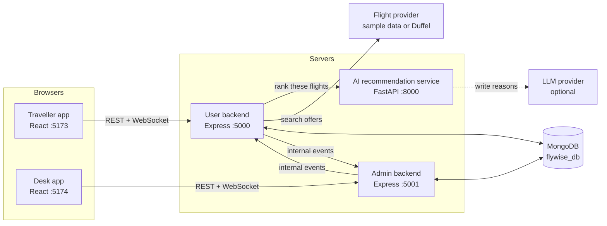
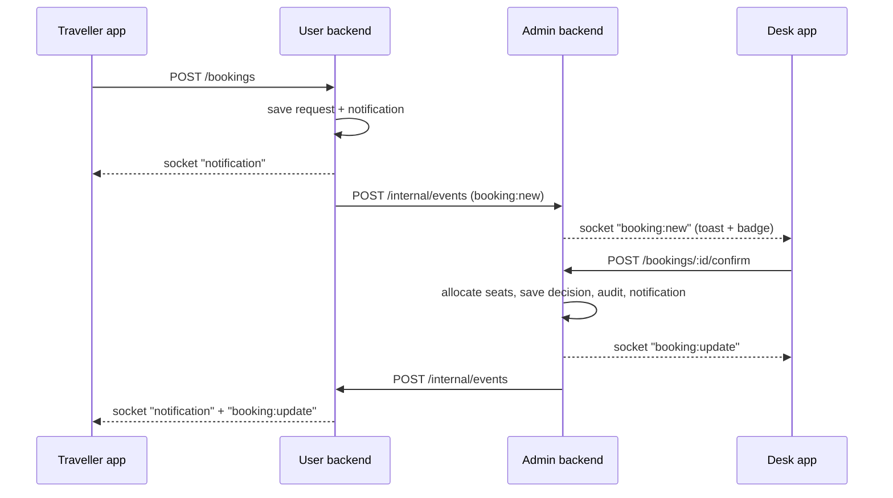

# Architecture

How FlyWise AI is put together, and why.

- [The big picture](#the-big-picture)
- [Why five programs](#why-five-programs)
- [Layers inside each backend](#layers-inside-each-backend)
- [Layers inside each frontend](#layers-inside-each-frontend)
- [The shared folder](#the-shared-folder)
- [How the programs talk to each other](#how-the-programs-talk-to-each-other)
- [Live updates](#live-updates)
- [Security](#security)
- [Reliability](#reliability)
- [Technology choices](#technology-choices)

---

## The big picture



| Program | Owns | Never does |
|---|---|---|
| Traveller app | What the traveller sees | Decide prices, statuses or permissions |
| Desk app | What the admin sees | Decide permissions |
| User backend | Traveller accounts, searches, booking requests, traveller notifications | Confirm, reject or revoke a booking |
| Admin backend | Desk accounts, decisions, seat inventory, audit log | Create traveller accounts or bookings |
| AI service | Ranking and explanations | Read or write the database, see personal data |

---

## Why five programs

**Two backends instead of one.** Travellers and admins are different audiences with different risks. Keeping them apart means:

- A traveller token is signed with `USER_JWT_SECRET` and an admin token with `ADMIN_JWT_SECRET`. The user backend does not even know the admin secret, so no bug in traveller code can mint an admin token.
- The code that confirms a booking is not present in the process that travellers talk to.
- Each can be rate-limited, deployed and scaled separately.

**Two frontends instead of one.** The desk app is never shipped to travellers, so its screens and API calls cannot be discovered by reading the public site's JavaScript.

**A separate AI service.** Ranking is the part most likely to change (new weights, a different model). It is written in Python, the usual language for that work, and it is stateless: flights in, recommendations out. If it is down, search still works (see [Reliability](#reliability)).

**One database.** Both backends read and write the same collections through the same schemas in `shared/models/`. For a project of this size, one database with a shared, documented schema is simpler and safer than keeping two copies in sync.

---

## Layers inside each backend

Both backends have the same shape. A request travels through the layers from top to bottom:

```
HTTP request
   │
   ▼
routes/        which URL, which middleware, which controller        (no logic)
   │
   ▼
middleware/    is the caller signed in? allowed? within limits?
validators/    is the request body exactly what we accept? (zod)
   │
   ▼
controllers/   read the validated request, call a service, send the reply
   │
   ▼
services/      the business rules: search, bookings, decisions, tokens ...
   │
   ▼
shared/models  MongoDB (Mongoose schemas)
```

Supporting folders:

| Folder | Purpose |
|---|---|
| `config/` | The only place that reads `process.env`. Everything else imports `config`. |
| `integrations/` | Code that talks to the outside world: flight providers, the AI service client. |
| `sockets/` | Socket.IO set-up and the functions that push live events. |
| `utils/serializers.js` | Turns database documents into API JSON, field by field. |
| `scripts/` (admin backend) | Command-line tasks: seed the admin, seed demo data, reset the database. |

**Why bother with layers?**

- **Routes read like a table of contents.** Open `routes/booking.routes.js` to see every booking URL and what protects it.
- **Rules live in one place.** "Only a pending request can be edited" is in `booking.service.js`, not scattered across handlers.
- **Each part can be tested alone.** The validators are tested without a server; the decision service is tested against a database without HTTP.

`server.js` only starts things (database, HTTP, sockets). `app.js` builds the Express app and can be created without opening a port.

### Example: cancelling a booking

```
POST /api/v1/bookings/:id/cancel
  routes/booking.routes.js        requireUser -> validate(cancelBookingSchema) -> bookings.cancel
  middleware/auth.js              checks the token, loads the account, sets req.user
  validators/booking.validators   body may contain only an optional "reason"
  controllers/booking.controller  calls bookingService.cancelBooking(user, id, reason)
  services/booking.service        conditional update PENDING/CONFIRMED -> CANCELLED,
                                  releases seats if it was confirmed,
                                  saves a notification, tells the desk
  utils/serializers               booking document -> JSON
```

---

## Layers inside each frontend

```
main.jsx         mounts React, the router and the context provider
App.jsx          renders the route table
routes/          AppRoutes.jsx (URL -> page) and the sign-in guard
pages/           one component per screen
components/      pieces used by several pages
context/         who is signed in + the live WebSocket channel
hooks/           reusable data loading (useLoad, usePagedList)
services/        api.js (the HTTP client) and one file per API area
```

Rules the frontends follow:

- **Pages never build URLs.** They call functions such as `listBookings()` or `confirmBooking(id)` from `services/`. Every endpoint the app uses is listed there.
- **One HTTP client.** `services/api.js` adds the token, unwraps the `{ success, data }` envelope and turns every failure into an error with a readable message. The traveller client also refreshes an expired access token once and retries.
- **The server is the authority.** Route guards only decide what to show. Every protected request is checked again on the server.
- **State stays local.** There is no global store. A context holds the signed-in user and a `liveTick` counter that increments when the server pushes an update; pages reload when it changes.

---

## The shared folder

| File | Used by | Contents |
|---|---|---|
| `constants.js` | All JavaScript programs, including the browser | Booking statuses, the state machine, status labels, airports, admin permissions |
| `models/` | Both backends | Mongoose schemas, one file per area |
| `http.js` | Both backends | `ApiError`, `ok()`, `validate()`, the error handler, pagination, the internal-key guard |
| `db.js`, `env.js`, `time.js` | Both backends | Database connection, `.env` loading, India Standard Time helpers |
| `design/theme.css` | Both frontends | Design tokens and the boarding-pass component |
| `ui/` | Both frontends | `Button`, `StatusPill`, `Notice`, `Field`, `Dialog` and the date / money formatters |

The repository is an **npm workspace**: `shared` and each folder in `apps/` is a package, and one `npm install` at the root links them. Backends import `@flywise/shared/...`; frontends use the `@shared/...` alias set in `vite.config.js`.

Putting the state machine in `shared/constants.js` means the desk app, the traveller app and both backends cannot disagree about which status may follow which.

---

## How the programs talk to each other

| From | To | How | Protected by |
|---|---|---|---|
| Traveller app | User backend | REST under `/api/v1` | `Authorization: Bearer <traveller token>`, CORS |
| Desk app | Admin backend | REST under `/api/v1/admin` | `Authorization: Bearer <admin token>`, CORS |
| User backend | AI service | `POST /recommend` | `x-internal-key` header |
| User backend | Admin backend | `POST /internal/events` | `x-internal-key` header |
| Admin backend | User backend | `POST /internal/events` | `x-internal-key` header |
| Both backends | MongoDB | Mongoose | Database access |

Every REST reply has the same envelope:

```json
{ "success": true,  "data": { }, "meta": { "page": 1, "limit": 20, "total": 42, "pages": 3 } }
{ "success": false, "error": { "code": "NO_SEATS", "message": "Not enough simulated seats ...", "details": [] } }
```

---

## Live updates

Both apps keep a Socket.IO connection open. The server decides who hears what:

- A traveller's socket must present a valid access token and is placed in a private room `user:<id>`. A traveller only ever receives their own events.
- A desk socket must present a valid admin token and joins the room `desk`.



The rule is **save first, push second**. The saved notification is the record; the socket push is a convenience. If a browser is closed or a push fails, nothing is lost: the notification is there the next time the page loads.

---

## Security

| Concern | What the project does | Where |
|---|---|---|
| Passwords | Stored as bcrypt hashes; the hash field is never selected by default | `auth.service.js`, `user.model.js` |
| Sessions (travellers) | 30-minute access token + 7-day refresh token that is rotated on every use | `token.service.js` |
| Sessions (admins) | One 8-hour token kept in `sessionStorage`, so closing the tab signs out | `admin-frontend/src/services/api.js` |
| Role separation | Separate collections, separate secrets, separate servers | `config/index.js` in each backend |
| Privilege escalation | Sign-up accepts only name, email, phone, password; unknown keys such as `role` are rejected | `validators/auth.validators.js` |
| Price tampering | The booking API accepts no price; the fare is copied from the server's stored offer | `booking.service.js` |
| Reading others' data | Every traveller query includes `userId`; another person's id answers 404 | `booking.service.js`, `notification.service.js` |
| Admin permissions | Each admin endpoint names the permission it needs; checked on the server | `routes/*.routes.js` in the admin backend |
| Input validation | Every body and query is checked by a zod schema before a controller runs | `validators/` |
| NoSQL injection | Keys starting with `$` or containing `.` are removed from every request; search text is escaped before use in a pattern | `shared/http.js` |
| Brute force | 40 sign-in attempts per 15 minutes per IP (30 on the desk) | `middleware/rateLimit.js` |
| Headers and origins | `helmet` security headers; CORS allows only the matching frontend | `app.js` |
| Service-to-service calls | Shared key, compared in constant time | `requireInternalKey` in `shared/http.js` |
| Error leaks | Unknown errors answer with a generic message; bodies are redacted in the server log | `errorHandler` in `shared/http.js` |
| Data sent to the LLM | Flight ids, prices, durations, stops, airline. No names, emails or phone numbers | `search.service.js` |
| Secrets | Read from `.env`, which is git-ignored. In production a missing secret stops the service | `shared/env.js` |

---

## Reliability

| Situation | Behaviour |
|---|---|
| AI service is down | The user backend ranks with the same formula locally and labels the result `LOCAL_FALLBACK` |
| LLM is down or returns nonsense | The AI service uses template explanations and labels the result `DETERMINISTIC` |
| LLM invents a flight id or a fare | That item is discarded; the deterministic pick and reason are used |
| Two admins confirm the last seat at the same moment | One succeeds; the other gets `NO_SEATS` and the request returns to the queue |
| The confirm button is clicked twice | The second call returns the existing confirmation; seats are taken once |
| The traveller cancels while the desk confirms | Each update is conditional on the current status, so exactly one wins |
| A confirmation crashes half-way | Seats are released; the request can be picked up again after 60 seconds |
| A socket push fails | Nothing is lost; the notification is already saved |
| The live flight provider fails | The search reports an error. It never silently switches to sample data |

How these work is explained in [workflows.md](workflows.md).

---

## Technology choices

| Choice | Why |
|---|---|
| React + Vite | Fast development server, small production builds, the most widely taught UI library |
| Tailwind CSS v4 | Design tokens live in one CSS file and become utility classes in both apps |
| Express | Minimal, widely understood, easy to layer |
| zod | One schema both validates a request and documents what it may contain |
| MongoDB + Mongoose | A booking is naturally one document (flight snapshot, passengers, history). Atomic single-document updates are enough to make allocation safe, so no multi-document transactions are needed |
| Socket.IO | Reconnects by itself and supports rooms, which gives per-traveller privacy cheaply |
| FastAPI + Pydantic | Typed request and response models for the ranking service; easy to test |
| JWT | Stateless checks that work the same for REST and for sockets |
| npm workspaces | One install, shared code without publishing packages |
