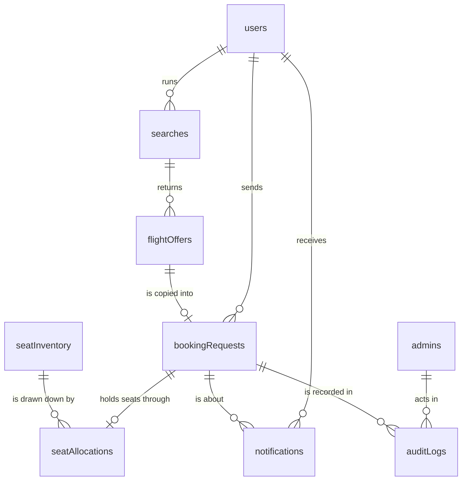

# Database design

FlyWise uses one MongoDB database, `flywise_db`, with eleven collections. The schemas are in `shared/models/`, one file per area, and are used by both backends.

- [Overview](#overview)
- [users](#users) · [admins](#admins)
- [searches](#searches) · [flightOffers](#flightoffers)
- [bookingRequests](#bookingrequests)
- [seatInventory](#seatinventory) · [seatAllocations](#seatallocations)
- [notifications](#notifications) · [auditLogs](#auditlogs)
- [settings](#settings) · [counters](#counters)
- [Indexes](#indexes)
- [Design decisions](#design-decisions)
- [Looking at the data](#looking-at-the-data)

---

## Overview



| Collection | Model file | Written by | Purpose |
|---|---|---|---|
| `users` | `user.model.js` | User backend (admin backend changes status only) | Traveller accounts |
| `admins` | `admin.model.js` | Admin backend seed script | Desk accounts |
| `searches` | `flight.model.js` | User backend | One document per search, with the three picks |
| `flightOffers` | `flight.model.js` | User backend | Every flight a search returned |
| `bookingRequests` | `booking.model.js` | Both backends | The central record |
| `seatInventory` | `inventory.model.js` | Both backends | Simulated seats per flight per day |
| `seatAllocations` | `inventory.model.js` | Both backends | Which booking holds how many seats |
| `notifications` | `notification.model.js` | Both backends | Messages for travellers |
| `auditLogs` | `audit.model.js` | Admin backend | Every desk action |
| `settings` | `setting.model.js` | Admin backend | One document of global settings |
| `counters` | `setting.model.js` | User backend | The booking-reference sequence |

Every collection except `auditLogs` and `counters` also has `createdAt` and `updatedAt`, maintained by Mongoose.

---

## users

| Field | Type | Notes |
|---|---|---|
| `name` | String | Required, up to 80 characters |
| `email` | String | Required, unique, stored lower-case |
| `phone` | String | Optional |
| `passwordHash` | String | bcrypt hash. Excluded from queries unless asked for explicitly |
| `role` | String | Always `USER` |
| `accountStatus` | String | `ACTIVE` or `SUSPENDED` |
| `refreshTokenId` | String | Id of the only refresh token still accepted; `null` after sign-out or suspension. Excluded from queries by default |

## admins

| Field | Type | Notes |
|---|---|---|
| `name`, `email` | String | Email is unique |
| `passwordHash` | String | bcrypt hash, excluded by default |
| `role` | String | Always `ADMIN` |
| `permissions` | [String] | Any of `VIEW_REQUESTS`, `APPROVE_BOOKINGS`, `REJECT_BOOKINGS`, `REVOKE_BOOKINGS`, `MANAGE_INVENTORY`, `MANAGE_USERS`, `VIEW_AUDIT_LOGS`, `MANAGE_SETTINGS` |
| `accountStatus` | String | `ACTIVE` or `SUSPENDED` |

Travellers and admins are separate collections on purpose: no field on a traveller document can turn it into an admin.

---

## searches

| Field | Type | Notes |
|---|---|---|
| `userId` | ObjectId → users | `null` for a search made without signing in |
| `origin`, `destination` | String | Airport codes |
| `departureDate` | String | `YYYY-MM-DD` |
| `passengers`, `cabinClass` | Number, String | |
| `preferences` | Object | What the traveller chose in the form |
| `naturalLanguage` | String | The free-text note |
| `appliedPreferences` | Object | What the ranking actually used, after reading the note |
| `provider`, `providerMode` | String | `MOCK` or `DUFFEL`; `MOCK` or `LIVE` |
| `engine` | String | `LLM`, `DETERMINISTIC`, `LOCAL_FALLBACK` or `NONE` |
| `engineNotes` | [String] | Messages shown on the results page |
| `recommendations` | [Object] | `{ offerId, category, reason, score }`, up to three |
| `offerCount` | Number | |

## flightOffers

One document per flight returned by a search. These fields are the **normalised flight**: the single shape every flight provider is converted into.

| Field | Type | Notes |
|---|---|---|
| `searchId` | ObjectId → searches | Indexed |
| `provider`, `providerOfferId` | String | Where it came from |
| `flightKey` | String | Flight number + date, for example `6E-2031_2026-11-25`. Identifies one inventory record |
| `airline`, `airlineCode`, `flightNumber` | String | |
| `origin`, `destination` | String | |
| `departureTime`, `arrivalTime` | Date | Stored in UTC, shown in India time |
| `durationMinutes`, `stops` | Number | |
| `segments` | [Object] | One per leg: airline, flight number, airports, times |
| `cabinClass` | String | `ECONOMY`, `PREMIUM_ECONOMY`, `BUSINESS` |
| `baggage` | Object | `{ cabin, checked }` |
| `currency`, `pricePerPassenger`, `passengerCount`, `price` | String, Numbers | `price` is the total for all passengers |
| `expiresAt` | Date | The fare is held until then (30 minutes for sample data) |

---

## bookingRequests

| Field | Type | Notes |
|---|---|---|
| `bookingReference` | String | Unique, human-readable: `FWB-2026-00014` |
| `userId` | ObjectId → users | The owner |
| `searchId`, `offerId` | ObjectId | Where the request came from |
| `recommendationCategory` | String | `BEST_OVERALL`, `CHEAPEST`, `FASTEST`, or `null` if the flight was not a pick |
| `flight` | Object | A **snapshot** of the offer (all normalised flight fields) |
| `passengers` | [Object] | `{ firstName, lastName, dateOfBirth, gender }`, at least one |
| `contact` | Object | `{ email, phone }` |
| `pricing` | Object | `{ amount, currency, perPassenger, passengerCount }`, copied from the offer |
| `status` | String | See [workflows.md](workflows.md#booking-statuses) |
| `inventoryMode` | String | Always `SIMULATED` |
| `adminDecision` | Object | `{ adminId, adminName, action, reason, decidedAt, idempotencyKey }`; `action` is `CONFIRM`, `REJECT` or `REVOKE` |
| `cancellation` | Object | `{ reason, at }` when the traveller cancelled |
| `history` | [Object] | `{ status, at, actor, note }`, appended on every change; `actor` is `USER`, `ADMIN` or `SYSTEM` |

Example:

```json
{
  "bookingReference": "FWB-2026-00014",
  "userId": "6741f0c2a1b2c3d4e5f60001",
  "status": "CONFIRMED",
  "inventoryMode": "SIMULATED",
  "recommendationCategory": "BEST_OVERALL",
  "flight": { "provider": "MOCK", "flightKey": "6E-2031_2026-11-25", "airline": "IndiGo", "flightNumber": "6E-2031",
              "origin": "BHO", "destination": "DEL", "departureTime": "2026-11-25T00:40:00Z",
              "durationMinutes": 95, "stops": 0, "price": 4849 },
  "passengers": [ { "firstName": "Rahul", "lastName": "Sharma", "dateOfBirth": "2003-05-10", "gender": "MALE" } ],
  "contact": { "email": "rahul@example.com", "phone": "9876543210" },
  "pricing": { "amount": 4849, "currency": "INR", "perPassenger": 4849, "passengerCount": 1 },
  "adminDecision": { "adminName": "Desk Admin", "action": "CONFIRM", "reason": "Simulated seat allocated",
                     "decidedAt": "2026-11-16T05:31:00Z" },
  "history": [
    { "status": "PENDING_ADMIN_APPROVAL", "actor": "USER",  "note": "Booking request sent" },
    { "status": "ALLOCATION_IN_PROGRESS", "actor": "ADMIN", "note": "Checking simulated seat inventory" },
    { "status": "CONFIRMED",              "actor": "ADMIN", "note": "1 simulated seat(s) allocated" }
  ]
}
```

---

## seatInventory

| Field | Type | Notes |
|---|---|---|
| `flightKey` | String | Unique. One record per flight per day |
| `flightNumber`, `airline`, `origin`, `destination`, `departureTime` | | For display |
| `totalSeats` | Number | Set by the desk, or the default from `settings` |
| `availableSeats` | Number | Decreases on confirm, increases on revoke or cancel. Never below 0 |
| `inventoryMode` | String | Always `SIMULATED` |

A record is created automatically the first time a traveller requests a flight, using `settings.defaultSimulatedSeats`. The desk can also add one in advance.

## seatAllocations

| Field | Type | Notes |
|---|---|---|
| `bookingId` | ObjectId → bookingRequests | **Unique**: a booking can hold seats at most once |
| `flightKey` | String | Indexed |
| `seats` | Number | The number of passengers |
| `status` | String | `ACTIVE` or `RELEASED` |
| `releasedAt` | Date | When the seats went back |

At any moment, for one flight: `totalSeats − availableSeats` equals the sum of `seats` over its `ACTIVE` allocations.

---

## notifications

| Field | Type | Notes |
|---|---|---|
| `userId` | ObjectId → users | Who it is for |
| `bookingId`, `bookingReference` | | The booking it is about |
| `type` | String | `BOOKING_REQUEST_CREATED`, `BOOKING_CONFIRMED`, `BOOKING_REJECTED`, `BOOKING_REVOKED`, `BOOKING_CANCELLED`, `BOOKING_FAILED` |
| `title`, `message` | String | |
| `read` | Boolean | |

## auditLogs

| Field | Type | Notes |
|---|---|---|
| `actorId`, `actorName`, `actorRole` | | The admin who acted |
| `action` | String | For example `BOOKING_CONFIRMED`, `INVENTORY_UPDATED`, `USER_SUSPENDED` |
| `bookingId`, `bookingReference` | | When the action concerns a booking |
| `previousStatus`, `newStatus` | String | For status changes |
| `reason` | String | The reason given to the traveller |
| `meta` | Object | Extra facts: seats taken, old and new totals, the idempotency key |
| `timestamp` | Date | Indexed |

Entries are only ever inserted. No API route updates or deletes one.

---

## settings

A single document with `_id: "global"`.

| Field | Type | Notes |
|---|---|---|
| `defaultSimulatedSeats` | Number | Seats given to a flight when its inventory is created automatically. Default 12 |

## counters

| Field | Type | Notes |
|---|---|---|
| `_id` | String | `booking-2026` (one per year) |
| `seq` | Number | Incremented atomically for each new booking reference |

---

## Indexes

| Collection | Index | Why |
|---|---|---|
| `users` | `email` unique | Sign-in; no duplicate accounts |
| `admins` | `email` unique | Sign-in |
| `searches` | `userId` | A traveller's past searches |
| `flightOffers` | `searchId` | Load a results page |
| `bookingRequests` | `bookingReference` unique | Look-up and uniqueness |
| `bookingRequests` | `userId, createdAt desc` | "My trips" |
| `bookingRequests` | `status, createdAt desc` | The desk queue and its tabs |
| `bookingRequests` | `flight.flightKey` | The duplicate-request check |
| `seatInventory` | `flightKey` unique | One record per flight per day |
| `seatAllocations` | `bookingId` unique | Makes a double allocation impossible |
| `seatAllocations` | `flightKey` | Allocations of one flight |
| `notifications` | `userId, createdAt desc` | The notification list |
| `auditLogs` | `timestamp` | Newest-first listing |

---

## Design decisions

**A booking stores a snapshot of its flight.** The `flight` object is copied from the offer when the request is created. Offers expire and searches are re-run, but a booking must always show exactly what the traveller asked for, at the fare they saw.

**History is embedded.** A booking's status changes are few and always read together with the booking, so they are an array on the document instead of a separate collection.

**Seats are a counter, not seat numbers.** The project is about approval and allocation, not seat maps. A counter that is decremented by one conditional update is the simplest thing that cannot oversell.

**Nothing is deleted.** Cancelling, rejecting and revoking change a status and add to the history. The record remains for the traveller, the desk and the audit log.

**No multi-document transactions.** Every step that must be safe is a single-document conditional update, which MongoDB applies atomically even on a standalone server. See [workflows.md](workflows.md#confirming-a-booking-in-detail).

---

## Looking at the data

With **MongoDB Compass**, connect to `mongodb://127.0.0.1:27017` and open `flywise_db`.

With the `mongosh` shell:

```js
use flywise_db
db.bookingRequests.find({ status: "PENDING_ADMIN_APPROVAL" }, { bookingReference: 1, "flight.flightNumber": 1 })
db.seatInventory.find({}, { flightKey: 1, totalSeats: 1, availableSeats: 1 })
db.auditLogs.find().sort({ timestamp: -1 }).limit(5)
```
