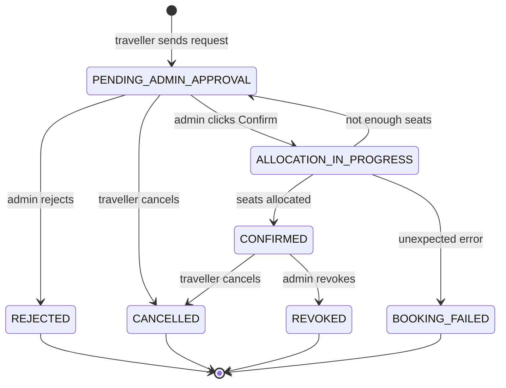
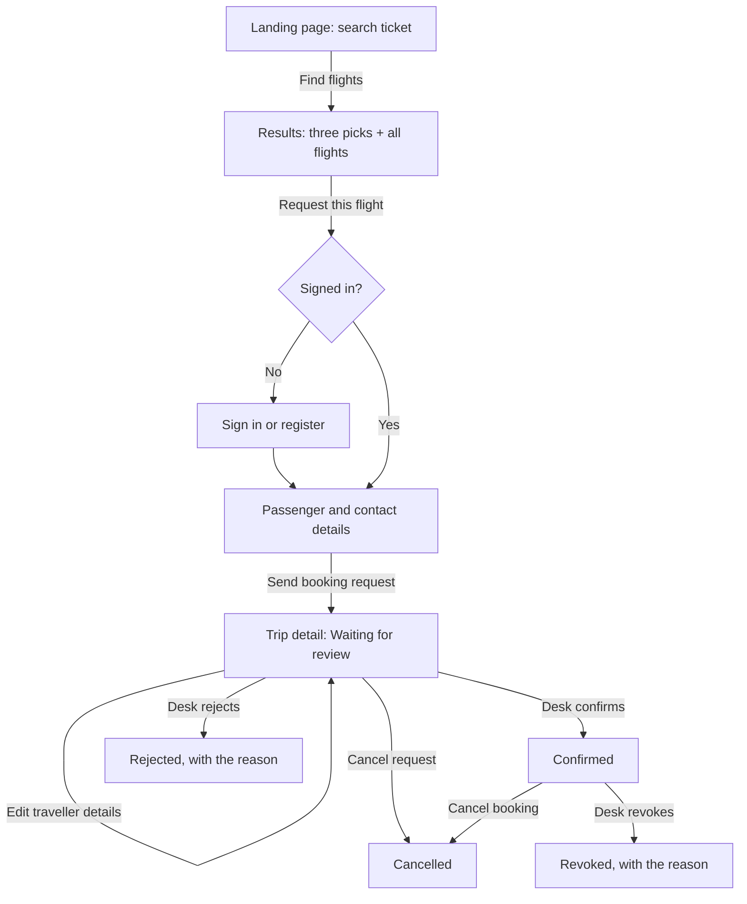
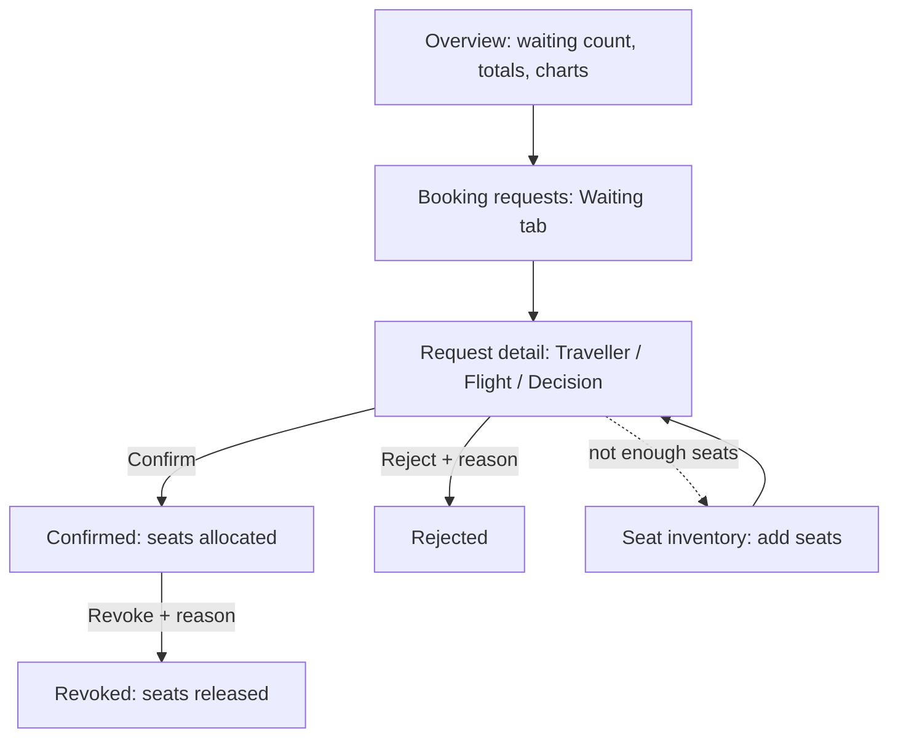
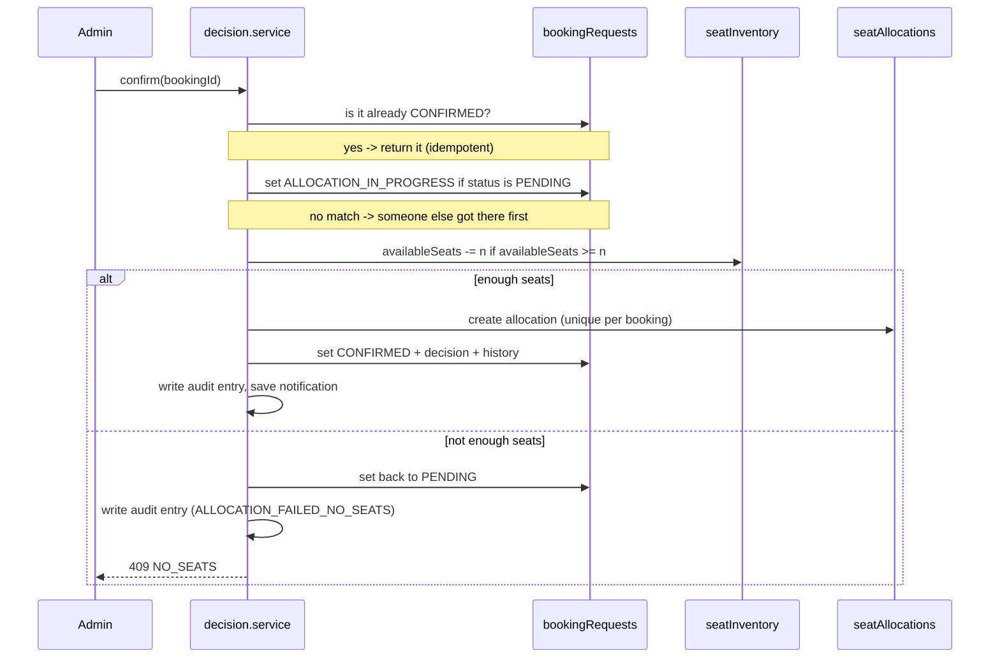

# Workflows

What happens, step by step, from a search to a final decision, and how the tricky cases are kept safe.

- [Booking statuses](#booking-statuses)
- [The state machine](#the-state-machine)
- [Traveller journey](#traveller-journey)
- [Desk journey](#desk-journey)
- [Confirming a booking, in detail](#confirming-a-booking-in-detail)
- [Reject, revoke and cancel](#reject-revoke-and-cancel)
- [How races are prevented](#how-races-are-prevented)
- [Notifications](#notifications)
- [The audit log](#the-audit-log)

---

## Booking statuses

| Status | Shown as | Meaning | Who sets it |
|---|---|---|---|
| `PENDING_ADMIN_APPROVAL` | Waiting for review | The request is in the desk's queue | Traveller (by sending it) |
| `ALLOCATION_IN_PROGRESS` | Allocating seats | A confirmation is running right now (normally well under a second) | Admin backend |
| `CONFIRMED` | Confirmed | Simulated seats are held for this booking | Admin |
| `REJECTED` | Rejected | The desk declined the request, with a reason | Admin |
| `REVOKED` | Revoked | A confirmed booking was withdrawn, with a reason; seats released | Admin |
| `CANCELLED` | Cancelled | The traveller cancelled | Traveller |
| `BOOKING_FAILED` | Failed | An unexpected error during allocation; seats released | System |
| `PRICE_REVALIDATION` | Checking the fare | Reserved for a future live-booking mode; not used today | n/a |

`SEARCHED` and `SELECTED` exist in the state machine for completeness but happen in the browser and are never stored.

**Reject and revoke are different things.** Reject applies to a request that was never approved. Revoke applies only to a booking that was confirmed, and it returns seats to inventory.

---

## The state machine

Defined once in `shared/constants.js` (`TRANSITIONS`) and used by every program.

`REJECTED`, `CANCELLED`, `REVOKED` and `BOOKING_FAILED` are terminal: nothing can leave them. A traveller who wants to try again sends a new request.

Every booking also carries a `history` array. Each status change appends `{ status, at, actor, note }`, so the full story of a request is on the request itself.

---

## Traveller journey

| Step | Page | API call |
|---|---|---|
| Search | Landing, `SearchTicket` | `POST /flights/search` |
| View results | Results | `GET /flights/search/:id` |
| Start a request | BookingNew | `GET /flights/offers/:id` |
| Send the request (**C**reate) | BookingNew | `POST /bookings` |
| See all trips (**R**ead) | MyBookings | `GET /bookings` |
| See one trip (**R**ead) | BookingDetail | `GET /bookings/:id` |
| Fix passenger or contact details (**U**pdate) | BookingDetail | `PATCH /bookings/:id` |
| Cancel (**D**elete, soft) | BookingDetail | `POST /bookings/:id/cancel` |

Rules enforced on the server:

- A fare is held for 30 minutes after a search. Requesting an expired offer answers `OFFER_EXPIRED`.
- The number of passengers must match the search.
- One open request per traveller per flight (`DUPLICATE_REQUEST`).
- Details can be edited only while the request is `PENDING_ADMIN_APPROVAL`. The flight itself can never be swapped.
- Cancelling is allowed from `PENDING_ADMIN_APPROVAL` and `CONFIRMED`. Nothing is deleted: the request stays, marked `CANCELLED`, with its history.

---

## Desk journey

The request detail screen shows the seat bar for that flight ("12 free of 60") and whether there are enough seats for this request. The Confirm button is disabled when there are not. Every decision goes through a confirmation dialog; reject and revoke require a reason of at least five characters, which the traveller sees.

Other desk screens: **Seat inventory** (add a flight, change a seat total), **Travellers** (suspend or reactivate an account), **Audit log**, **Settings** (default seats for new flights; health of the other services).

---

## Confirming a booking, in detail

This is the heart of the project. The code is `confirmBooking` in `apps/admin-backend/src/services/decision.service.js`.

1. **Already confirmed?** Return the existing result. A double click or a retried request does nothing new.
2. **Claim the request.** One database update says "set `ALLOCATION_IN_PROGRESS` only if the status is still `PENDING_ADMIN_APPROVAL`". MongoDB applies single-document updates one at a time, so only one caller can win. Everyone else gets `IN_PROGRESS` or `INVALID_TRANSITION`.
3. **Take the seats.** Another single update: "subtract N from `availableSeats` only if at least N are available". If two bookings compete for the last seat, exactly one of these updates matches.
4. **Record the allocation.** `seatAllocations.bookingId` has a unique index. If a retry somehow reaches this point twice, the second insert fails and the extra seats are handed straight back.
5. **Finalise.** Status becomes `CONFIRMED`, the decision (admin, time, idempotency key) is stored, an audit entry is written, and a notification is saved and pushed.

If anything unexpected goes wrong after step 2, the seats are released, the booking is marked `BOOKING_FAILED`, and the traveller is told. If the server itself dies mid-way, the claim becomes stale after 60 seconds and another confirm attempt may take it over.

**Why no database transaction?** Each step is a single-document conditional update, which MongoDB guarantees to be atomic on any deployment, including a plain local install. Multi-document transactions would need a replica set.

---

## Reject, revoke and cancel

| Action | Allowed from | Seats | Reason | Who |
|---|---|---|---|---|
| Reject | `PENDING_ADMIN_APPROVAL` | None were taken | Required | Admin with `REJECT_BOOKINGS` |
| Revoke | `CONFIRMED` | Released back to inventory | Required | Admin with `REVOKE_BOOKINGS` |
| Cancel | `PENDING_ADMIN_APPROVAL`, `CONFIRMED` | Released if it was confirmed | Optional | The traveller who owns it |

Releasing seats is also made safe against repeats: the allocation is flipped from `ACTIVE` to `RELEASED` in one conditional update, and only the caller that flipped it adds the seats back. Releasing twice returns zero the second time.

---

## How races are prevented

| Race | What stops it |
|---|---|
| Two admins confirm the same request | The claim in step 2 matches once |
| Two requests compete for the last seat | The conditional decrement in step 3 matches once |
| The same confirm is sent twice | Step 1 returns the existing confirmation; the unique allocation index is the backstop |
| Traveller cancels while the admin confirms | Cancel requires `PENDING` or `CONFIRMED`; confirm requires `PENDING`. Whichever update lands first wins and the other reports a conflict |
| Traveller edits while the admin decides | The edit requires `PENDING`; if the decision landed first, the edit answers `NOT_EDITABLE` |
| Admin lowers a seat total below what is allocated | The inventory update requires enough free seats to absorb the change; otherwise `INVENTORY_CONFLICT` |
| Two requests created at the same instant | The booking reference comes from an atomic counter, so numbers never repeat |

The integration tests in `apps/admin-backend/tests/decisions.integration.test.js` exercise the first three with concurrent calls against a real database.

---

## Notifications

| Type | Sent when | Message says |
|---|---|---|
| `BOOKING_REQUEST_CREATED` | A request is sent | It is waiting for review |
| `BOOKING_CONFIRMED` | The desk confirms | Confirmed with a simulated seat; not an airline ticket |
| `BOOKING_REJECTED` | The desk rejects | The reason |
| `BOOKING_REVOKED` | The desk revokes | The reason |
| `BOOKING_CANCELLED` | The traveller cancels | It has been cancelled |
| `BOOKING_FAILED` | Allocation fails unexpectedly | Search again to send a new request |

Each is saved in the `notifications` collection first, then pushed to the traveller's open browser tabs. The bell in the header shows the unread count.

---

## The audit log

Every desk action writes one entry: who, what, when, to which booking, from which status to which, and why.

| Action | Written when |
|---|---|
| `BOOKING_CONFIRMED` | A booking is confirmed (includes seats taken and seats left) |
| `ALLOCATION_FAILED_NO_SEATS` | A confirm attempt found too few seats |
| `BOOKING_REJECTED` | A request is rejected |
| `BOOKING_REVOKED` | A booking is revoked (includes seats released) |
| `BOOKING_FAILED` | An allocation failed unexpectedly |
| `INVENTORY_CREATED`, `INVENTORY_UPDATED` | Inventory is added or a total is changed (old and new value) |
| `USER_SUSPENDED`, `USER_REACTIVATED` | A traveller account's status is changed |
| `SETTINGS_UPDATED` | The default seat count is changed (old and new value) |

The API can only list entries. There is no route that edits or deletes one.
